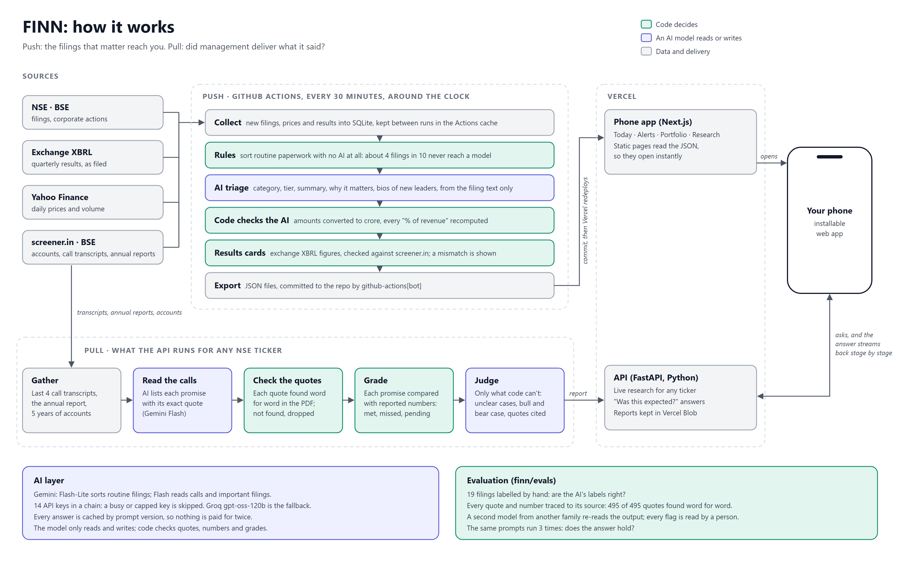
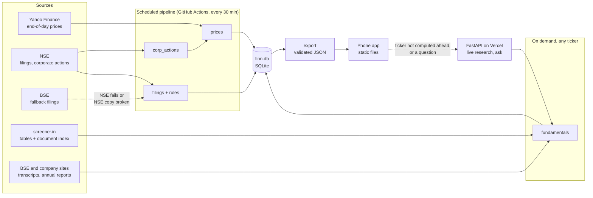
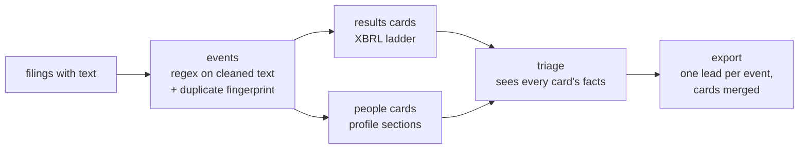
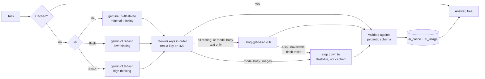
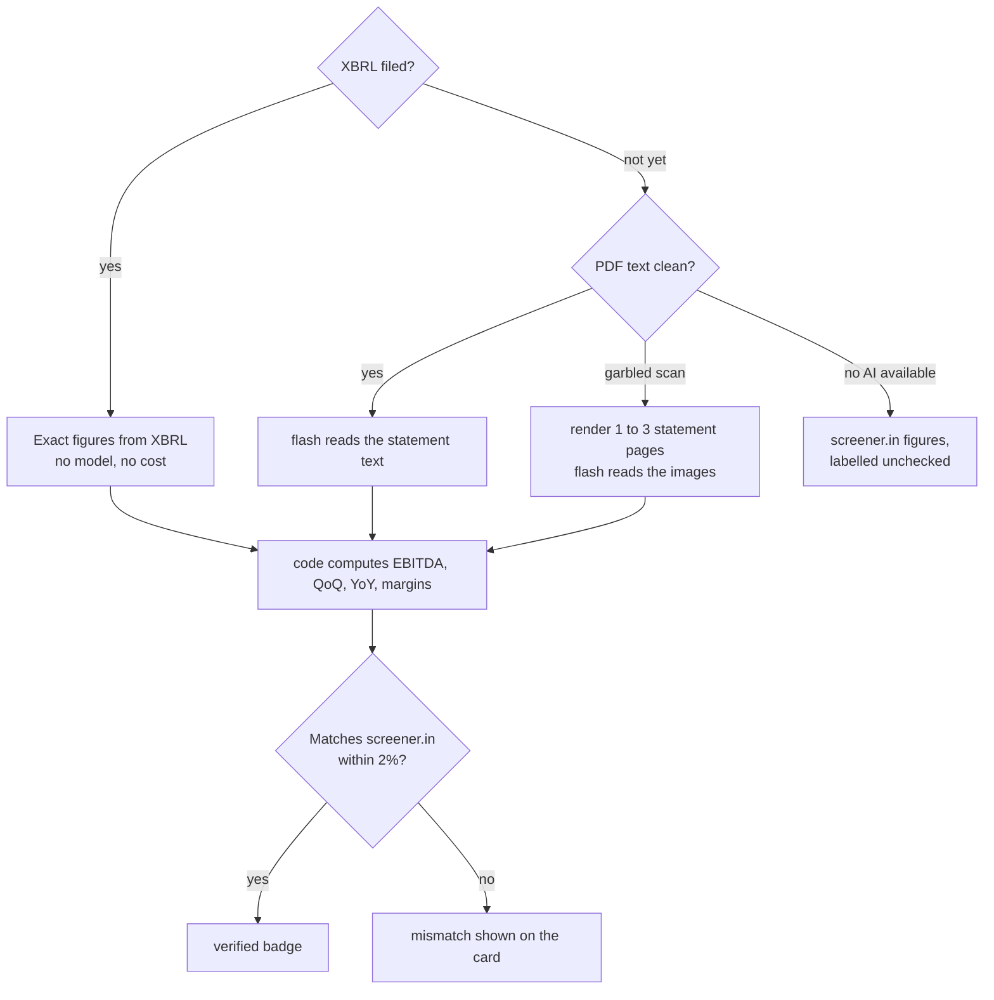
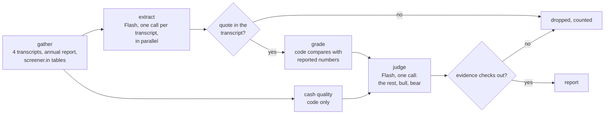

# FINN architecture

FINN filters the daily flood of exchange filings, prices and fundamentals down to the few
things an investor needs to see. This document covers the data layer, the AI layer and
the research engine and the phone app.



Green boxes are decided by code, purple ones by an AI model. The model reads and writes;
code checks every quote, number and grade. Source: [architecture.svg](architecture.svg).

## The shape of the system



Push screens read static JSON files, so they open instantly. Only a research request on an
uncached ticker, or a question about a filing, ever needs the live server. Both halves
deploy as one Vercel project with two services, the Next.js app and the FastAPI backend,
on one domain (decision D21).

## Decisions and why

| Decision | Why |
|---|---|
| **Static-first.** The pipeline writes JSON that the app loads directly. | Free-tier servers sleep and take about a minute to wake. The investor's daily screens should never wait on that. |
| **Thresholds live in the app.** The data layer ships each day's move and volume ratio. | The investor decides what "unusual" means. Changing 2x volume to 3x needs no server and no re-run. |
| **Rules before AI.** A rule table sorts filings by the exchange's subject line first. | On 601 real filings from October 2026, rules settled 46% with no model call and set the category for 70%. Routine PDFs are never even downloaded. |
| **Every row has provenance.** Each table stores `source_url` and `fetched_at`. | Any number on screen can be traced to its source. That is the basis for citing every claim in research. |
| **Corporate-action days are marked.** Prices carry the ex-date of demergers, splits and bonuses. | Yahoo does not adjust for demergers. Vedanta's demerger on 30 April 2026 looks like a 65% crash, and alerts must not report it as one. |
| **Text quality is judged, not assumed.** Each PDF gets `ok`, `garbled` or `no_text`. | Maruti's and IndusInd's Q2 FY27 results are scans with a corrupted text layer, where "1,005,746" reads "I,005,746". Garbled PDFs are kept for a vision model, and their text is never trusted for numbers. |
| **Downloads are verified, with BSE as the second copy.** | NSE's stored copy of HDFC Bank's Q2 results is truncated on NSE's own server. The downloader rejects incomplete files and fetches the same filing from BSE. |
| **Only three annual-report sections are located.** These are the auditor's report, contingent liabilities and related-party transactions. | These carry the risk signals for the bear case. Parsing hundreds of other pages adds cost, not insight. |
| **screener.in is an index, not the record.** | Its tables are a cross-check and a source for cash-flow history. The documents themselves are fetched from BSE or the company. Its pages are cached for 12 hours and never committed, per its personal-use terms. |
| **One JSON contract.** Pydantic models validate every export and write a JSON Schema. | The frontend generates its types from the schema, so the two sides cannot drift apart silently. |
| **Code reviews every model answer before it is stored** (`review()` in `enrich/triage.py`, using `grounding.py`). | The evaluation found answers that read well and were wrong: a share count shown as ₹270,000,000 crore, an invented total, a "% of revenue" 100 times off. Code now drops figures it cannot trace to the filing, and a large deal is at least must-see whichever model answered. See `finn/evals/REPORT.md`. |
| **Stand-in answers are asked again.** When Flash is busy or capped, Flash-Lite or Groq answers; on important filings Flash is asked again later. | Measured: 17 of 19 labels right on Flash, 10 to 12 on the stand-ins. A stand-in's answer is better than an empty card, but not good enough to keep. |
| **The refresh schedules itself.** Each run starts the next 30 minutes later; GitHub's cron only restarts the chain. | GitHub's scheduled runs stopped, then came hours late, after a default-branch switch. A workflow may start a run of itself with its own token, which does not depend on the scheduler. |
| **A data refresh needs no new deployment.** Pages read the data from the repository and are rebuilt in the background every 5 minutes; Vercel builds only when code changes. | Every deployment stores a copy of the server, and 48 data deployments a day filled the free plan's 10 GB of function storage on 30 October. Now the data stays current even if deployments are blocked, and no request meets a server mid-redeploy. |

## Being a good citizen

- Each site has its own minimum gap between requests. A full refresh makes about 400 requests over several minutes.
- Transient failures are retried with exponential backoff and jitter. Anything else fails fast with the status code.
- screener.in gets a User-Agent naming this project. NSE and BSE reject unknown clients, so they get a standard browser User-Agent. Nothing spoofs TLS fingerprints or solves bot challenges. If an exchange refuses, FINN falls back to the other exchange or to cached data.

## Supply-chain hygiene

- Every Python dependency, direct or transitive, is resolved with uv's `exclude-newer` cutoff. Nothing released in the 14 days before locking is used, because that is where regressions and compromised uploads show up first.
- `uv.lock` pins exact versions with hashes.
- GitHub Actions are pinned to full commit SHAs.

| Component | Version | Why this one |
|---|---|---|
| Python | 3.14.7 | A year of patch releases, and supported a year longer than 3.13. Python 3.15 is weeks old. |
| uv | 0.13 | Lockfile, Python management and fast installs in one tool. |
| yfinance | 1.7.0 | Latest. No breaking changes since 1.4. |
| pandas | 3.0.6 | 3.1.0 is newer than the cutoff. |
| pypdfium2 | 5.14.0 | 5 to 60 times faster than pypdf on our filings, with cleaner text, and it can render page images for the vision step. Permissive licence, unlike PyMuPDF's AGPL. |
| requests and tenacity | 2.34.2 and 9.1.4 | Plain, well-understood HTTP with explicit retry policy. |
| beautifulsoup4 and lxml | 4.15.0 and 6.1.3 | Readable parsing. Speed is irrelevant at a few pages per company. |
| pydantic | 2.14.1 | The export contract, shared later with the FastAPI server. |
| google-genai | 2.29.0 | 2.30.1 was uploaded on the cutoff day itself, so the 14-day rule excluded it. |
| groq | 1.7.0 | Latest. Used only as the text fallback. |
| tenacity | 9.1.4 | google-genai 2.29 requires tenacity below 9.2. |
| Pillow | 12.3.0 | Turns rendered PDF pages into PNGs for the vision model. 13.0 is newer than the cutoff. |

## Data model

| Table | One row per | Key columns |
|---|---|---|
| `companies` | company | symbol, BSE code, bank or not, screener URL |
| `prices` | company per trading day | close, volume, `ret_pct`, `vol_ratio`, `corp_action` |
| `corp_actions` | corporate action | ex-date, kind, subject |
| `filings` | exchange announcement | category, tier, rule that fired, `needs_ai`, text quality, paths to text and kept PDF |
| `documents` | transcript, annual report, presentation or results PDF | period, text path, page count, located annual-report sections |
| `financials` | line item per period | statement, basis, value, raw text |
| `runs` | pipeline run | start, finish, success, per-stage stats |
| `filing_signals` | filing | events found in its text, text fingerprint, `duplicate_of` |
| `results_cards` | company per quarter | the card as JSON, its source rung, verified or not |
| `people_cards` | filing with a leadership change | each person, the change, role, profile, where the profile came from |
| `filing_insights` | filing | category, tier, title, summary, why it matters, amount, the model that answered |
| `ai_cache`, `ai_usage`, `ai_key_state` | answer, call, key per model | cached answers, tokens and latency, key cooldowns |

## The AI layer

Every model call goes through one client, `finn.ai.llm.LLM`. It routes by difficulty,
caches every answer, works down an ordered queue of keys, and logs each real call with
its tokens and latency.

### From filing to card



| Decision | Why |
|---|---|
| **Events are found in the text, not the subject line.** One filing can carry several. | Nazara's 12 October board outcome, filed as "Allotment of Securities", also carried a new CFO, a director resignation and two redesignations. A notice of a future meeting ("to consider") is not an event; a decision ("approved") is. |
| **Cards are built before triage.** | Triage gets the computed results numbers and the people on the card, so its one-line summary states the real move, such as Mazagon Dock's PAT down 53.8% year on year, instead of "results declared". |
| **Copies of one letter cost nothing.** | Companies file one letter under several labels: in 140 readable filings, 22 were copies, six of them Nazara's. A text fingerprint finds them; the copy takes the original's answer, and the app shows the event once. |
| **Letterheads are filtered narrowly.** | Only lines that are mostly Devanagari or dense with OCR noise go, and never a line with a number and %, ₹, crore or lakh. A broader "looks like words" filter dropped real lines such as Nazara's "• Revenue: 803 (+53% YoY)". |
| **The model copies amounts; code converts them.** | Asked for crore, the model turned Persistent's "INR 42,646.09 million" into ₹42,646 crore, ten times too much. Now it copies the figure and its unit, and code converts. |
| **Names match exactly, after undoing OCR slips.** | "Rohit Shanna" in a scanned letter is Rohit Sharma. A similarity score would also merge Rohit and Mohit Sharma, who score 0.92 and are different people. |



An answer that does not fit the schema is a problem with the model's answer, not the key: on
28 October the judge's answer for Dixon failed validation on every key for 16 minutes,
because high thinking used up the output budget and cut the JSON short. Now a cut-off
answer is detected from the model's finish reason, two unusable answers move the call to
the next model, and a live request has a deadline: past it no new call starts, and the
report says what it could not finish.

A quota limit belongs to one key, so the next key answers. A capacity error belongs to the
model: on 27 October, gemini-3.8-flash returned 503 "high demand" on every key, and one
call took 270 seconds. So requests time out at 90 seconds, and once two keys report a 503,
504 or timeout, the model is skipped for three minutes. A step-down answer is used but not
cached, and triage asks Flash again on the next run for any important filing that got one.

| Task | Tier | Why this tier |
|---|---|---|
| Triage: category, tier, title, summary, why it matters | lite, 6 filings per call | High volume and simple judgement. Batching uses one request where six would be needed. |
| Triage of results, leadership, deals, fund raises, litigation and pledges | flash, 6 per call | On these, Flash-Lite added facts the filing does not state, such as an "ICICI merger" for HDFC Bank's new CEO. |
| Bios from a filing's profile section | lite | Copying facts out of a short, structured section. |
| Results numbers from a PDF's text or page images | flash | Tables need accuracy, and images need a vision model. Only needed until the XBRL arrives. |
| Promised vs. delivered, bull vs. bear (next step) | reason | The few calls that compare and judge. |

### The results ladder



| Decision | Why |
|---|---|
| **XBRL before any model.** | Companies file machine-readable results with the exchange. They are exact and free. On 27 October all seven portfolio companies that had reported got their card from XBRL, with no model call. |
| **No local OCR.** | The broken text in Maruti's and IndusInd's PDFs is already somebody's OCR. Tesseract-class OCR fails on scanned tables the same way, and would add a system binary to every host. Vision is only for the hours before XBRL arrives. |
| **Code does the arithmetic.** | Models copy numbers from the page; EBITDA, percentage changes and margins are computed in Python, so they cannot be hallucinated. |
| **EBITDA uses screener.in's definition.** | Revenue minus operating costs, where operating costs exclude interest and depreciation. It is unaffected by exceptional items or associates. |
| **The check knows how associates are presented.** | Companies put the share of associates' profit in different places. Maruti shows its ₹69 crore below PBT, and Mazagon Dock's ₹48.5 crore sits inside it. screener.in normalises it. The check accepts either presentation and says which one matched. |
| **Mismatches are shown, not hidden.** | HDFC Bank's consolidated PBT and PAT from XBRL are ₹837 crore below screener.in's, with no associates or minority share to explain it. The card says so. |
| **Banks get their own card.** | Banks have no revenue or EBITDA. The card shows net interest income, operating profit before provisions, provisions, PBT and PAT. |

### Keys and cost

- Keys sit in `backend/.env` locally and in GitHub's encrypted secrets for the scheduled run. Logs and the database only ever see aliases such as `gemini-3`.
- A key that hits a per-minute limit rests for 65 seconds. One that hits its daily quota rests until Google's reset at midnight Pacific time. Cooldowns live in SQLite, so separate runs respect each other.
- Requests are paced at about 9 a minute per key, under the free tier's limit of roughly 10.
- The backlog of 30 days is 113 filings after copies are removed, in 19 triage calls. A normal day produces about 6 filings, which means 1 or 2 calls.

## The research engine

Pull research answers one question first: did management do what it said? The brief calls
promised against delivered "the kind of thing we value most", so it is the flagship. The
principle is the results card's: **the model reads, code judges.**



| Decision | Why |
|---|---|
| **No vector database.** Each transcript is read whole. | Four transcripts are 52K to 111K tokens and the three annual-report sections about 30K; every model in use takes a million. Cutting transcripts into chunks for retrieval would separate a promise from the later call that tests it. |
| **Every quote is checked by code.** | The model copies quotes; code finds each one in its document, ignoring line wraps, spacing and running headers, and records the page. What the app shows is the document's own words at that place. A claim whose quote is not there is dropped. In the first runs, 64 of 64 Kaynes quotes and 44 of 44 Infosys quotes were found. |
| **Code grades whatever numbers allow.** | A company-wide promise in rupees about a period that has ended is compared with screener.in's tables: Kaynes promised FY26 revenue of at least ₹4,000 crore and reported ₹3,626 crore, so code marks it missed. Constant-currency guidance, such as Infosys's, is compared with management's own later statement of the outcome. |
| **Definitions are matched, not assumed.** | Infosys guides on operating margin, which is EBIT. screener.in's OPM is EBITDA, 24% against an EBIT margin of 20.9%. Comparing the wrong pair would have called a met target beaten, so EBIT margin is computed as operating profit less depreciation. Asian Paints' volume growth is not revenue growth, so it is never graded against revenue. A quarter's growth is graded only when the speaker says what it compares with: HFCL's "10% to 15% in this current quarter" was 50.6% over the previous quarter and 127.7% over a year ago. |
| **Segment targets are never graded against company numbers.** | "OSAT and PCB revenue of ₹450 to 500 crore" compared with Kaynes's total revenue would read as beaten many times over. Each claim says whether it is company-wide. |
| **The model's verdicts are held to rules in code.** | A promise is not evidence for itself. Before its period ends, or with no period, it can only be on track or at risk. After the period, with nothing reported, it is unclear. Bull and bear points need evidence that exists, and a point whose annual-report quote is not in the report is dropped. |
| **Cash quality is arithmetic.** | Operating cash flow against profit over five years, free cash flow and working-capital days come straight from the accounts. For Kaynes, −₹615 crore of operating cash against ₹977 crore of reported profit. Banks are skipped: their cash flow moves with deposits and loans. |
| **"Ask about this" answers from the last two calls.** | A Push card's question, such as why Mazagon Dock's margin fell, is answered from what management said before the result. The answer is shown only with at least one quote found in the transcripts. |
| **Missing calls come from NSE.** | screener.in lists transcripts late, and misses some: Maruti's July 2026 call never appeared, so its report stopped at April. FINN reads a year of NSE announcements and takes every call screener.in lacks, one per call, until it has the newest four. When a quarter's results are out but its call is not filed, the report says so. |
| **Reports keep up with their companies** (`research/update.py`). | Each refresh compares what a report was built from with what the company has filed since. A new call transcript, or results a day old, puts it behind. Two are rebuilt per run; each call's reading is cached, so only new calls cost a model. Only a complete report reading at least as many calls replaces the old one, and a report still behind says so on screen. |

| Stage | Model | Measured |
|---|---|---|
| Extract claims | Flash, low thinking, 4 calls in parallel | On Kaynes's February call, Flash-Lite found 1 promise and Flash 11, including the two Kaynes later missed. Recall is the foundation, so extraction runs on Flash. |
| Judge | Flash, high thinking, 1 call | Sees only checked claims, code verdicts, cash facts and annual-report excerpts |
| Ask | Flash, low thinking, 1 call | 6 seconds for Mazagon Dock |
| A ticker never seen before | all of the above | Titan, live: cash quality on screen at 8 seconds, the full report at 69 seconds |

## The phone app

A Next.js app in `app/`, built for a phone screen first and checked down to 320 pixels wide.

| Screen | What it does |
|---|---|
| Today | A briefing ("FINN read 14 filings; 1 matters"), then Today's 3 as full cards, the rest as one-liners, and routine filings folded into one line. Each top card answers "Was this expected?" from the company's last two calls. New items since your last visit get a dot. |
| Alerts | Your own limits for price moves, volume and kinds of filing, saved on the phone and applied at once. Only must-see filings alert. Corporate-action days, such as demergers, are skipped. |
| Portfolio | The 18 holdings, most attention first, with three months of prices. |
| Research | Search any NSE company by name or symbol, from NSE's own list of 2,618. The 23 prepared reports are static pages; any other company is researched live, with results shown as each stage finishes. |

| Decision | Why |
|---|---|
| **Static pages from the pipeline's JSON.** | Screens open instantly and never wait on a server. The cloud job commits new data every 30 minutes, which redeploys the app. |
| **One time window for Today and Alerts.** | The brief: "by default the last 24 hours, but let me pick the period". Presets or any custom dates. On a quiet day the app opens on the smallest window with something must-see, and says so. |
| **The phone's clock decides "now".** | A page built hours ago must not decide what "the last 24 hours" means, so time-based screens render after the page loads. |
| **Types generated from the backend's schema.** | A renamed field fails the app's build instead of breaking a screen. |
| **Live reports kept in Vercel Blob.** | A server's temporary disk is wiped on every redeploy, so a live report is stored durably and served instantly next time. |
| **Installable.** | "Add to Home Screen" opens FINN full-screen with its own icon. |

## Running it

```bash
cd backend
uv sync
uv run python -m finn.refresh            # Push data for the portfolio, then export
uv run python -m finn.fetch INFY         # fundamentals and documents for any ticker
uv run python -m finn.fetch --research-set
uv run python -m finn.enrich --dry-run   # what the AI step would do, and its cost
uv run python -m finn.enrich             # results cards, triage, bios, then export
uv run python -m finn.research --all     # research for the 23 companies, written for the app
uv run uvicorn finn.api:app              # live research and "ask about this"
uv run pytest
```
