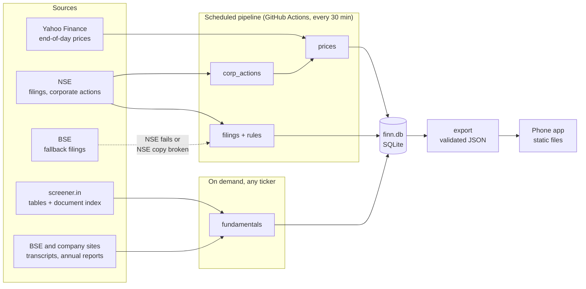

# FINN architecture

FINN filters the daily flood of exchange filings, prices and fundamentals down to the few
things an investor needs to see. This document covers the data layer, which is built. The
AI layer and the app are added in later steps and get their own sections.

## The shape of the system



Push screens read static JSON files, so they open instantly. Only a research request on an
uncached ticker ever needs a live server.

## Decisions and why

| Decision | Why |
|---|---|
| **Static-first.** The pipeline writes JSON that the app loads directly. | Free-tier servers sleep and take about a minute to wake. The investor's daily screens should never wait on that. |
| **Thresholds live in the app.** The data layer ships each day's move and volume ratio. | The investor decides what "unusual" means. Changing 2x volume to 3x needs no server and no re-run. |
| **Rules before AI.** A rule table sorts filings by the exchange's subject line first. | On 601 real filings from October 2026, rules settled 46% with no model call and set the category for 70%. Routine PDFs are never even downloaded. |
| **Every row has provenance.** Each table stores `source_url` and `fetched_at`. | Any number on screen can be traced to its source. That is the basis for citing every claim in research. |
| **Corporate-action days are marked.** Prices carry the ex-date of demergers, splits and bonuses. | Yahoo does not adjust for demergers. Vedanta's demerger on 30 April 2026 looks like a 65% crash, and alerts must not report it as one. |
| **Text quality is judged, not assumed.** Each PDF gets `ok`, `garbled` or `no_text`. | Maruti's and IndusInd's Q2 FY27 results are scans with a corrupted text layer, where "1,005,746" reads "I,005,746". Garbled PDFs are kept for a vision model, and their text is never trusted for numbers. |
| **Downloads are verified, with BSE as the second copy.** | NSE's stored copy of HDFC Bank's Q2 results is truncated on NSE's own server. The downloader rejects incomplete files and fetches the same filing from BSE. |
| **Only three annual-report sections are located.** These are the auditor's report, contingent liabilities and related-party transactions. | These carry the risk signals for the bear case. Parsing hundreds of other pages adds cost, not insight. |
| **screener.in is an index, not the record.** | Its tables are a cross-check and a source for cash-flow history. The documents themselves are fetched from BSE or the company. Its pages are cached for 12 hours and never committed, per its personal-use terms. |
| **One JSON contract.** Pydantic models validate every export and write a JSON Schema. | The frontend generates its types from the schema, so the two sides cannot drift apart silently. |

## Being a good citizen

- Each site has its own minimum gap between requests. A full refresh makes about 400 requests over several minutes.
- Transient failures are retried with exponential backoff and jitter. Anything else fails fast with the status code.
- screener.in gets a User-Agent naming this project. NSE and BSE reject unknown clients, so they get a standard browser User-Agent. Nothing spoofs TLS fingerprints or solves bot challenges. If an exchange refuses, FINN falls back to the other exchange or to cached data.

## Supply-chain hygiene

- Every Python dependency, direct or transitive, is resolved with uv's `exclude-newer` cutoff. Nothing released in the 14 days before locking is used, because that is where regressions and compromised uploads show up first.
- `uv.lock` pins exact versions with hashes.
- GitHub Actions are pinned to full commit SHAs.

| Component | Version | Why this one |
|---|---|---|
| Python | 3.14.7 | A year of patch releases, and supported a year longer than 3.13. Python 3.15 is weeks old. |
| uv | 0.13 | Lockfile, Python management and fast installs in one tool. |
| yfinance | 1.7.0 | Latest. No breaking changes since 1.4. |
| pandas | 3.0.6 | 3.1.0 is newer than the cutoff. |
| pypdfium2 | 5.14.0 | 5 to 60 times faster than pypdf on our filings, with cleaner text, and it can render page images for the vision step. Permissive licence, unlike PyMuPDF's AGPL. |
| requests and tenacity | 2.34.2 and 9.2.1 | Plain, well-understood HTTP with explicit retry policy. |
| beautifulsoup4 and lxml | 4.15.0 and 6.1.3 | Readable parsing. Speed is irrelevant at a few pages per company. |
| pydantic | 2.14.1 | The export contract, shared later with the FastAPI server. |

## Data model

| Table | One row per | Key columns |
|---|---|---|
| `companies` | company | symbol, BSE code, bank or not, screener URL |
| `prices` | company per trading day | close, volume, `ret_pct`, `vol_ratio`, `corp_action` |
| `corp_actions` | corporate action | ex-date, kind, subject |
| `filings` | exchange announcement | category, tier, rule that fired, `needs_ai`, text quality, paths to text and kept PDF |
| `documents` | transcript, annual report, presentation or results PDF | period, text path, page count, located annual-report sections |
| `financials` | line item per period | statement, basis, value, raw text |
| `runs` | pipeline run | start, finish, success, per-stage stats |

## Running it

```bash
cd backend
uv sync
uv run python -m finn.refresh            # Push data for the portfolio, then export
uv run python -m finn.fetch INFY         # fundamentals and documents for any ticker
uv run python -m finn.fetch --research-set
uv run pytest
```
